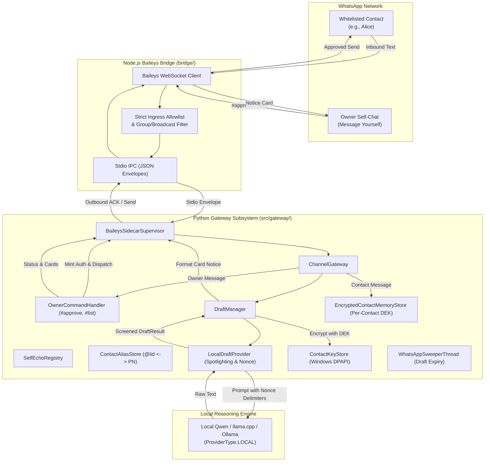
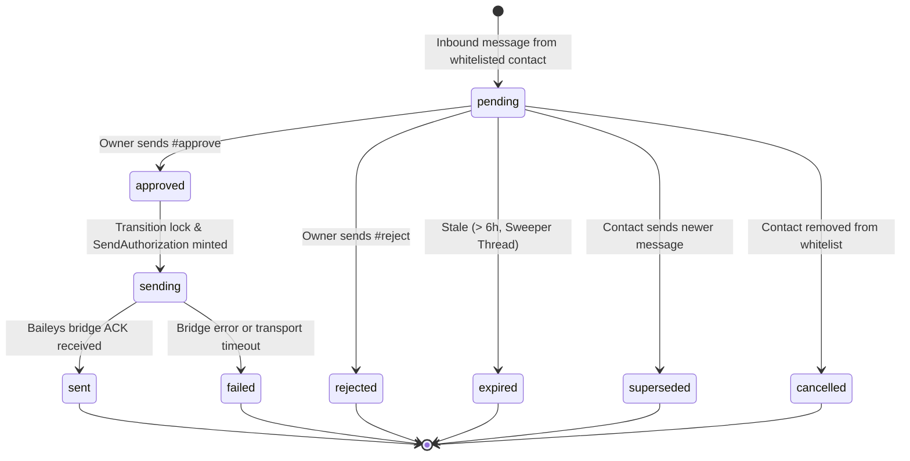

# AEGIS WhatsApp Autonomous Agent Subsystem

> **Autonomous Provenance Note**: *This subsystem was built entirely through prompt-driven autonomous development across 8 structured tasks.*

---

## 1. Overview & Architectural Invariants

The AEGIS WhatsApp Agent is a local-first, privacy-preserving messaging subsystem designed to assist the user by reading incoming text messages from a small, curated whitelist of contacts (up to 12), drafting contextual replies exclusively using a local on-device language model, and sending **nothing** until the owner explicitly approves each draft from their dedicated "message yourself" self-chat.

### Core Architectural Invariants
1. **0 Unsanctioned Outbound Sends**: The agent cannot autonomously send outbound WhatsApp messages to external contacts. Every dispatch requires an unforgeable, single-use `SendAuthorization` minted strictly upon explicit owner approval (`#approve <ID>`).
2. **Local Model Only (Data Sovereignty)**: Contact message texts are never transmitted to cloud endpoints, remote APIs, or external telemetry. If local model routing is unavailable, the agent fails closed.
3. **Strict Contact Isolation**: Contact messages never reach `CommandRouter`, `CentralBrain`, or `ToolBroker`. They are restricted to contact-scoped encrypted memory and draft generation.
4. **Per-Contact Cryptographic Isolation**: Contact history and pending drafts are encrypted using individual per-contact Data Encryption Keys (DEKs) protected via Windows DPAPI under SQLCipher.
5. **No Group or Broadcast Chats**: Groups, channels, communities, and broadcast stanzas are dropped unconditionally at both the Node bridge boundary and the Python ingress parser.

---

## 2. Architecture & Data Flow



---

## 3. Threat Model & Defensive Design

### 3.1 Untrusted Inbound Messages
- Inbound contact messages are treated as potentially malicious and untrusted.
- **Fail-Closed Gate**: If the contact is not in the whitelist, the message is dropped immediately with an audit log. Even for whitelisted contacts, messages are completely isolated from command routing.

### 3.2 Indirect Prompt Injection Defense
- **Spotlighting with Dynamic Nonces**: Inbound contact texts are enclosed within high-entropy cryptographic nonces: `<<<USER_INPUT_<nonce>>>> ... <<</USER_INPUT_<nonce>>>>`.
- **Delimiter Sanitization**: Literal occurrences of delimiter fragments (`<<<`, `>>>`, `SYSTEM OVERRIDE`, etc.) inside message text are escaped or normalized prior to model ingestion.
- **Heuristic Injection Screening**: Inbound texts are scanned against high-entropy prompt injection heuristics (e.g., instructions to ignore constraints, reveal passwords, or leak nonces). If detected, an injection hint is injected into the local prompt, the draft is forced to neutral tone, and a high-visibility `⚠️ WARNING: Possible prompt injection detected` badge is attached to the owner's approval card.
- **Output Leak Screening**: The generated draft is verified to ensure it never quotes the cryptographic nonce, system instructions, or internal delimiter tags.

### 3.3 Contact Isolation & PII Protection
- Memory and draft ciphertexts use AES-256-GCM with distinct per-contact keys derived via PBKDF2/DPAPI.
- Logs and audit trails strictly enforce **zero-leakage of message text**: messages are audited using SHA-256 hashes, character lengths, and category codes. Phone numbers are masked (e.g., `...0001@s.whatsapp.net`).

---

## 4. Approval Lifecycle & State Machine



### Owner Administrative Commands (`OwnerCommandHandler`)
Commands are sent directly within the owner's WhatsApp self-chat:
- `#list`: Lists all active pending drafts with IDs, contact labels, and expiration times.
- `#approve <ID>` (or `#a <ID>`): Approves the draft, verifies tamper integrity (re-hashing against stored `text_sha256`), mints `SendAuthorization`, and dispatches.
- `#edit <ID> <text>`: Overwrites draft text and re-delivers an updated card notice.
- `#reject <ID>` (or `#r <ID>`): Rejects and discards the pending draft.
- `#contacts`: Displays the current whitelist and per-contact drafting styles.
- `#mode <index_or_number> <normal|banter>`: Toggles drafting mode for a contact.
- `#pause` / `#resume`: Globally suspends or resumes draft approvals.
- `#help`: Explains available commands.

---

## 5. Banter Style Guide & Safety Boundaries

For contacts configured with `banter` mode, the local model drafts informal, witty responses reflecting familiarity. However, banter is automatically suppressed to neutral/safe tone under two strict guardrails:

### 16 Protected Sensitive Topics
If an incoming message or drafted reply touches any of the 16 protected categories, banter is suppressed (`banter_suppressed=True`), and a professional/safe neutral refusal or acknowledgment is drafted:
1. `medical_and_health`: Chest pain, dosage, diagnosis, prescriptions, illness.
2. `legal_and_law`: Contracts, lawsuits, litigation, lawyers, arrests.
3. `finance_and_investment`: Stock picks, crypto, investments, loans, wire transfers.
4. `grief_and_bereavement`: Death, funerals, loss of loved ones, mourning.
5. `mental_health_crisis`: Self-harm, suicide, depression crisis, panic attacks.
6. `substance_use`: Hard drugs, addiction, overdosing.
7. `physical_safety`: Assault, stalkers, physical emergencies, domestic abuse.
8. `employment_and_firing`: Termination, lay-offs, severance, HR disciplinary action.
9. `romance_and_breakups`: Divorces, breakups, infidelities.
10. `government_and_taxes`: Tax audits, IRS notices, visas, legal deportations.
11. `cybersecurity_and_credentials`: Passwords, OTPs, seed phrases, 2FA codes.
12. `religious_or_communal_disputes`: Blasphemy, sectarian conflicts, religious tensions.
13. `politics_and_elections`: Ballot controversies, election disputes.
14. `minor_safety`: Child welfare, underage safety concerns.
15. `personal_secrets_and_confessions`: Explicit confessions of wrongdoing.
16. `urgent_money_requests`: Emergency borrowing, urgent UPI/wire transfers.

*Multilingual Coverage*: Protected topics are screened in English, Hindi (Latin & Devanagari), and Marathi (Latin & Devanagari).

### Banned Terms Screening
Drafts are rejected and cleared if they contain profanity, slurs, or harassment across supported languages. Matching is Unicode-aware (NFKC normalized, zero-width character stripped, leetspeak resilient) without false positives on legitimate sub-words.

---

## 6. Configuration & CLI Reference

### 6.1 Subcommands
```bash
# Show WhatsApp gateway and bridge operational status
python -m src.cli whatsapp status [--db-path PATH]

# Run offline scripted 5-turn demo simulation
python -m src.cli whatsapp run --simulate [--scenario PATH] [--db-path PATH]

# Run live WhatsApp supervisor with Baileys bridge
python -m src.cli whatsapp run [--auth-dir PATH] [--owner-jid JID] [--db-path PATH]

# Manage whitelisted contacts
python -m src.cli whatsapp contacts list
python -m src.cli whatsapp contacts add +919876543210 --label "Alice" --mode banter
python -m src.cli whatsapp contacts mode +919876543210 normal
python -m src.cli whatsapp contacts remove +919876543210
```

### 6.2 Preflight Safety Checks (All 7 Must Pass Before Bridge Spawn)
1. **Database Schema**: Database readable and schema at latest migration version.
2. **Whitelist Non-Empty**: At least 1 contact whitelisted.
3. **Owner JID Configured**: Canonical phone number format (`^\d{7,15}@s\.whatsapp\.net$`).
4. **Node.js Environment**: Node.js >= 18 available on system `PATH`.
5. **Bridge Dependencies**: `bridge/node_modules/` present and installed.
6. **Local Model Verified**: Active model registered as `ProviderType.LOCAL` (refuses cloud routing).
7. **Auth Directory Writable**: Baileys session storage directory permissions verified.
